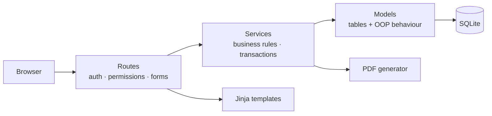
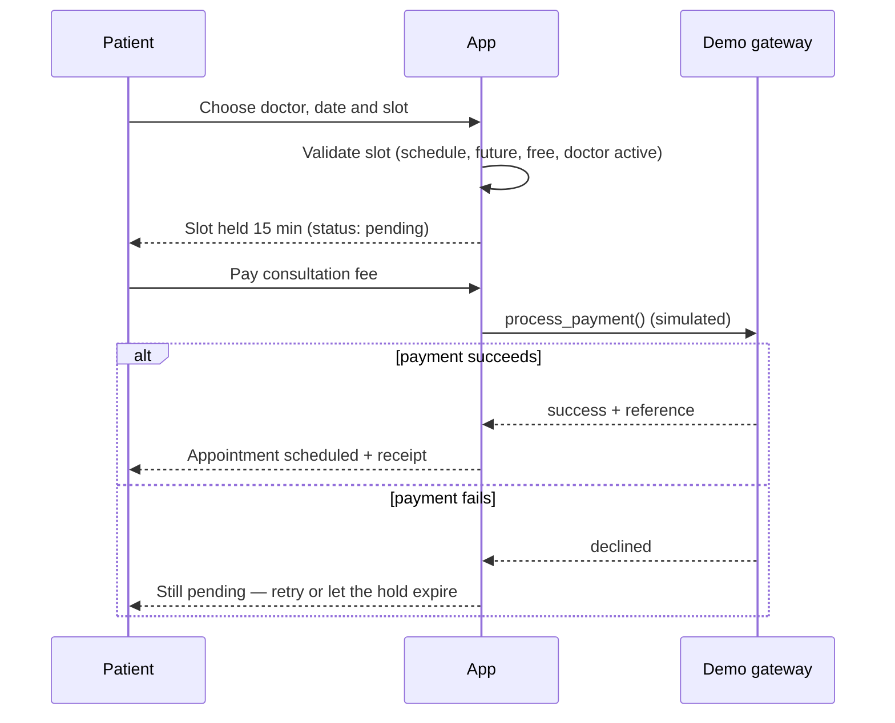

<div align="center">

# 🏥 Smart Hospital Management & Emergency Response System

**A full-stack hospital management demo — four role-based portals, simulated payments, insurance billing, a priority emergency queue and PDF invoices — built with Python & Flask.**

<p>
  
  
  
  
</p>
<p>
  
  
  
  
</p>


[Quick start](#-quick-start) · [Features](#-features) · [Architecture](#-architecture) · [Demo logins](#-demo-logins) · [Tests](#-testing) · [Docs](#-documentation)

</div>

> [!WARNING]
> **Demo project.** All people, medicines, diagnoses and reports are fictional. **Payments are simulated — no real money is charged and no card data is stored.** This is a learning project, not a certified clinical or production system, and it makes no compliance claims (HIPAA, GDPR, etc.).

---

## 📑 Table of contents

- [Overview](#-overview)
- [Features](#-features)
- [Tech stack](#-tech-stack)
- [Architecture](#-architecture)
- [OOP concepts demonstrated](#-oop-concepts-demonstrated)
- [Business rules](#-business-rules)
- [Quick start](#-quick-start)
- [Demo logins](#-demo-logins)
- [Testing](#-testing)
- [Security](#-security)
- [Project structure](#-project-structure)
- [Limitations](#-limitations)
- [Troubleshooting](#-troubleshooting)
- [Documentation](#-documentation)
- [Credits](#-credits)

---

## 🔎 Overview

One centralized database, four portals, each seeing only what its role allows:

| | Portal | In one line |
|:-:|---|---|
| 🧑‍⚕️ | **Patient** | Find a doctor, book and pay (simulated), follow treatment, download reports and invoices |
| 👨‍⚕️ | **Doctor** | Record consultations, plan treatment, publish reports, approve discharge |
| 👩‍⚕️ | **Nurse** | See assigned patients and add nursing notes |
| 🛠️ | **Admin / Reception** | Doctors, rooms, medicines, emergency queue, billing, insurance and discharge |

---

## ✨ Features

### 🧑‍⚕️ Patient portal
- Register / sign in, edit profile
- Search doctors by **name, specialization, department and maximum fee**
- See real free slots and **book only genuinely available times** (double-booking is impossible)
- Pay the consultation fee through a **clearly labelled demo gateway** (UPI · Card · Cash) — the booking is confirmed **only after payment succeeds**
- Upcoming / pending / completed / cancelled appointments, with a documented cancellation & refund policy
- **Treatment timeline**, published medical reports, **PDF invoices & reports**, payment history, outstanding balance and insurance summary

### 👨‍⚕️ Doctor portal
- Dashboard with today's and upcoming appointments and consultation payment status
- Open **only your own patients** (enforced on the server)
- Record consultation + diagnosis; appointments can be completed **only after** a consultation is recorded
- Four treatment plan types, progress & medication notes, discharge approval
- Write reports and **publish** them to the patient (only the author can publish)

### 🛠️ Admin / reception portal
- KPI dashboard with charts, low-stock alerts and recent activity
- Manage doctors, nurses and patients (create · edit · deactivate), fees, schedules
- Rooms (assign / release, editable daily rates), medicine inventory with stock history
- **Emergency priority queue**, billing, insurance policies, payments, insurer settlement
- **Discharge checklist** showing exactly which conditions are unmet

### 🎨 Experience
Responsive layout (desktop · tablet · mobile), Indian-rupee formatting, pagination, search & filters, confirmation dialogs, inline validation messages, custom 403/404/500 pages and a printable HTML invoice fallback.

---

## 🧰 Tech stack

| Layer | Technology |
|---|---|
| Backend | Python, **Flask** (application factory), Flask-Login, Flask-WTF / WTForms (CSRF) |
| Database | **SQLite** via Flask-SQLAlchemy / SQLAlchemy 2, Flask-Migrate wired in |
| Frontend | Jinja2 templates, **Bootstrap 5**, vanilla JavaScript, **Chart.js** (all bundled — works offline) |
| PDF | **ReportLab** (invoices and medical reports, with bundled DejaVu font for ₹) |
| Testing | **pytest** |

---

## 🏗️ Architecture



**Routes stay thin** — they check who you are and validate input. **Services own the rules** (no double booking, no negative stock, discharge conditions…). **Models** hold the data and the behaviour that belongs to each object.

### Booking & payment flow



---

## 🧠 OOP concepts demonstrated

| Pillar | Where to look |
|---|---|
| **Inheritance** | `HospitalUser` → `Patient`, `Doctor`, `Nurse` · `Payment` → UPI / Card / Cash / Insurance · `Treatment` → Medicine / Surgery / Physiotherapy / Emergency |
| **Encapsulation** | `Patient.__medical_history` and `__wallet_balance` behind properties and methods (name mangling discourages accidental access — real protection is server-side authorization) |
| **Abstraction** | `abc.ABC` + `@abstractmethod`: `Payment.process_payment()`, `Treatment.perform_treatment()` / `calculate_cost()` |
| **Polymorphism** | Overridden `display_details()`, `calculate_consultation_fee()`, `calculate_cost()`, `process_payment()` — selected through **registries**, not `if/elif` chains |

Magic methods in use: `__str__`, `__eq__` / `__hash__` (patients compared by ID), `__lt__` (emergency priority), `__add__` (charge summaries), `__len__` (emergency queue).

---

## 📏 Business rules

<details>
<summary><b>Consultation fees (configurable by admin)</b></summary>

| Specialization | Fee |
|---|---:|
| General Physician | ₹500 |
| Cardiologist | ₹1,500 |
| Neurologist | ₹1,800 |
| Surgeon | ₹2,500 |

</details>

<details>
<summary><b>Treatment costs</b></summary>

| Type | Formula |
|---|---|
| Medicine | medicine charges + consultation charges |
| Surgery | operation + surgeon + hospital charges |
| Physiotherapy | session charge × number of sessions |
| Emergency | emergency charges + treatment charges |

</details>

<details>
<summary><b>Rooms (daily rate, editable)</b></summary>

| Room | Rate / day |
|---|---:|
| General Ward | ₹1,000 |
| Private Room | ₹3,000 |
| ICU | ₹7,000 |
| Emergency Room | ₹5,000 |

Charge = rate × days. Every *started* 24-hour period counts as one day, minimum one day. An occupied room cannot be assigned again.

</details>

<details>
<summary><b>Insurance</b></summary>

Insurer share = `min(bill × coverage %, policy maximum, bill)`. Example: ₹50,000 bill · 80% cover · ₹30,000 cap → insurer pays **₹30,000**, patient pays **₹20,000**. Insurance is modelled as the insurer's share of the bill (never also as a discount), and the insurer's later settlement is tracked separately.

</details>

<details>
<summary><b>Emergency queue</b></summary>

Level 1 Critical · 2 Serious · 3 Moderate · 4 Minor. Lower number is served first; equal levels keep arrival order (`heapq` + `__lt__`).

</details>

<details>
<summary><b>Discharge — all four must be true</b></summary>

1. Treatment completed
2. Doctor approval recorded
3. Bill generated
4. Payment completed (patient balance zero; insurer share settled when insurance applies)

Unmet conditions are listed by name. A successful discharge releases the room.

</details>

---

## 🚀 Quick start

**Requirements:** Python 3.12 recommended (3.10 – 3.13 should work) and Git.

```powershell
# 1. Get the code
git clone https://github.com/Mohak-Mittal/Smart_Hospital_Management.git
cd Smart_Hospital_Management

# 2. Virtual environment
py -3 -m venv .venv
.venv\Scripts\Activate.ps1

# 3. Install dependencies
python -m pip install --upgrade pip
python -m pip install -r requirements.txt

# 4. Optional: configure settings
copy .env.example .env

# 5. Create the database AND load demo data (both steps are required)
python scripts\init_db.py
python scripts\seed_demo_data.py

# 6. Run
python run.py
```

Open **http://127.0.0.1:5000** and sign in with a [demo login](#-demo-logins).

> [!IMPORTANT]
> Run **both** `init_db.py` and `seed_demo_data.py` before `run.py`. Starting the server on an empty database gives `no such table` errors.

<details>
<summary><b>macOS / Linux</b></summary>

```bash
git clone https://github.com/Mohak-Mittal/Smart_Hospital_Management.git
cd Smart_Hospital_Management
python3 -m venv .venv
source .venv/bin/activate
python -m pip install -r requirements.txt
cp .env.example .env
python scripts/init_db.py
python scripts/seed_demo_data.py
python run.py
```

</details>

<details>
<summary><b>Reset the demo data</b></summary>

```powershell
python scripts\seed_demo_data.py --reset
```

Drops every table and recreates the demo data. To start completely empty, delete `instance\hospital.db` and run `init_db.py` again.

</details>

---

## 🔑 Demo logins

All seeded accounts share one password: **`Demo@12345`** — for local demonstration only.

| Role | Email | Notes |
|---|---|---|
| 🛠️ Admin | `admin@hospital.demo` | Full hospital access |
| 👨‍⚕️ Doctor — General Physician | `doctor@hospital.demo` | Dr. Rohan Mehta, holds the main demo patient data |
| 👨‍⚕️ Doctor — Cardiologist | `cardio@hospital.demo` | |
| 👨‍⚕️ Doctor — Neurologist | `neuro@hospital.demo` | |
| 👨‍⚕️ Doctor — Surgeon | `surgeon@hospital.demo` | |
| 👩‍⚕️ Nurse | `nurse@hospital.demo` | Assigned to Vikram Singh |
| 🧑 Patient | `patient@hospital.demo` | Priya Sharma — one confirmed booking |
| 🧑 Patient (insured, admitted) | `patient2@hospital.demo` | Vikram Singh — 80% / ₹30,000 policy, room G-101, treatment, reports, bill |
| 🧑 Patient | `patient3@hospital.demo` | Kavya Iyer — booked a cardiologist |
| 🧑 Patient | `patient4@hospital.demo` | Imran Khan — unpaid booking and an emergency case |

**Demo payment values**

| Method | Succeeds | Fails |
|---|---|---|
| UPI | any id like `name@bank` | ids ending in `@fail` |
| Card | `4242 4242 4242 4242`, any future expiry (e.g. `12/40`), any 3-digit CVV | `4000 0000 0000 0002` |
| Cash | always (issues a demo receipt) | — |

Card numbers and CVVs are validated in memory and **never stored**.

---

## ✅ Testing

```powershell
python -m pytest              # 93 tests, each on its own temporary database
python scripts\smoke_test.py  # end-to-end check: real CSRF, all four roles
```

The suite covers registration and login, cross-patient access, doctor/patient assignment rules, double-booking, inactive doctors, payment success and failure, insurance caps, partial payments, room and stock rules, emergency ordering, discharge blocking and room release, and PDF download permissions. Tests never touch your demo database.

---

## 🔐 Security

- Passwords stored only as salted hashes (Werkzeug)
- CSRF protection on every form; safe redirects after login
- **Server-side authorization on every route** — role decorators, a guard on the whole admin blueprint, and ownership checks (a patient can only open their own bills and reports; a doctor only their linked patients)
- Output escaping in HTML and PDFs; strict Content-Security-Policy with no inline scripts
- Basic login throttling; deactivated accounts lose their session immediately
- No card numbers or CVVs stored; no medical data written to logs

---

## 🗂️ Project structure

```text
Smart_Hospital_Management/
├── run.py                  # entry point
├── config.py               # settings (env-driven)
├── requirements.txt
├── .env.example
├── app/
│   ├── models/             # tables + OOP classes
│   ├── services/           # business rules
│   ├── routes/             # thin web routes per portal
│   ├── templates/          # Jinja pages & components
│   ├── static/             # CSS, JS, bundled Bootstrap/Chart.js, fonts
│   └── utils/              # decorators, PDF, validators, ID generator
├── scripts/                # init_db.py · seed_demo_data.py · smoke_test.py
├── tests/                  # pytest suite
└── docs/                   # overview · class diagram · DB schema · user guide
```

---

## ⚠️ Limitations

- **Payments are simulated** — there is no gateway and no network call. Do not add real card processing to this code.
- **Not production-ready** — no encryption at rest, email/SMS, HTTPS or backups. A real deployment needs a production WSGI server, HTTPS, PostgreSQL and a strong secret key.
- **SQLite** serialises writes; double booking is still prevented by a service check *and* a partial unique index.
- Login throttling is **in-memory** and resets on restart.
- All times are **hospital local time** (`HOSPITAL_TIMEZONE`, default `Asia/Kolkata`).
- A room stay is billed once, at the moment a bill is generated.
- Python 3.12 is the tested version; 3.14 is untested.

---

## 🩹 Troubleshooting

| Problem | Fix |
|---|---|
| `no such table` | Run `python scripts\init_db.py` and `python scripts\seed_demo_data.py` before `run.py` |
| PowerShell blocks `Activate.ps1` | `Set-ExecutionPolicy -Scope Process -ExecutionPolicy Bypass`, then activate again |
| `ModuleNotFoundError` | Activate `.venv` and run `python -m pip install -r requirements.txt` |
| Package build errors on a very new Python | Use Python 3.12 or 3.13 |
| Port 5000 already in use | Close the other program, or change the port in `run.py` |
| `database is locked` | Close other programs using `instance\hospital.db` |
| Too many login attempts | Wait 5 minutes or restart the server |
| "Your form session expired" | Refresh the page and submit again |
| ₹ missing in PDFs | Keep the bundled `app/static/fonts` folder |

---

## 📚 Documentation

| Document | Contents |
|---|---|
| [`docs/PROJECT_OVERVIEW.md`](docs/PROJECT_OVERVIEW.md) | Architecture, security model, OOP map, business rules |
| [`docs/CLASS_DIAGRAM.md`](docs/CLASS_DIAGRAM.md) | Mermaid class diagram |
| [`docs/DATABASE_SCHEMA.md`](docs/DATABASE_SCHEMA.md) | Tables, constraints, relationships |
| [`docs/USER_GUIDE.md`](docs/USER_GUIDE.md) | Walkthrough for each role and a 5-minute demo script |

---

## 🙏 Credits

Built by **[Mohak Mittal](https://github.com/Mohak-Mittal)** as a learning project.

Bundled third-party assets: [Bootstrap](https://getbootstrap.com/) 5.3.3 (MIT), [Chart.js](https://www.chartjs.org/) 4.4.4 (MIT) and DejaVu Sans fonts (free license — see `app/static/fonts/DEJAVU_LICENSE.txt`).

<div align="center">

<sub>Demo project · sample data only · simulated payments · not for real clinical use</sub>

</div>
