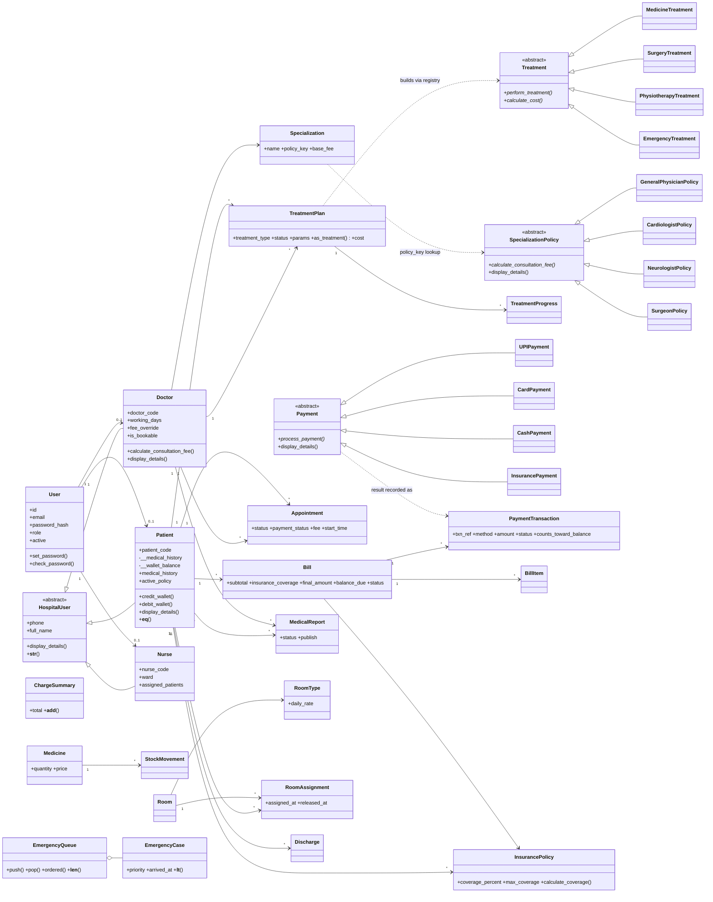

# Class diagram

`*` after a method name marks it **abstract**. Service classes/modules (`appointment_service`, `payment_service`,
`billing_service`, `inventory_service`, `room_service`, `emergency_service`, `treatment_service`,
`discharge_service`) hold the business rules that coordinate these classes.
